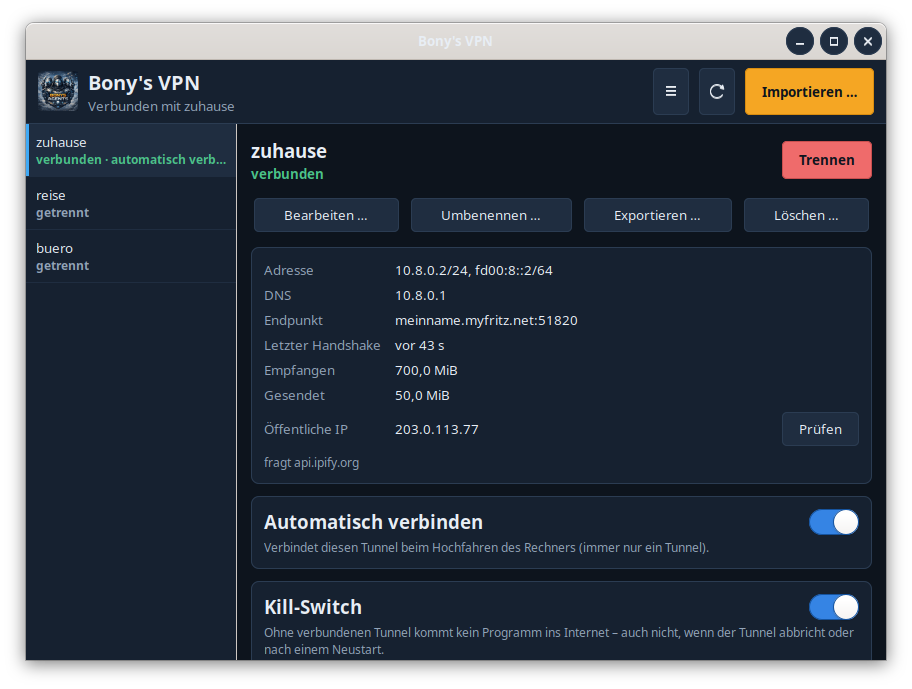
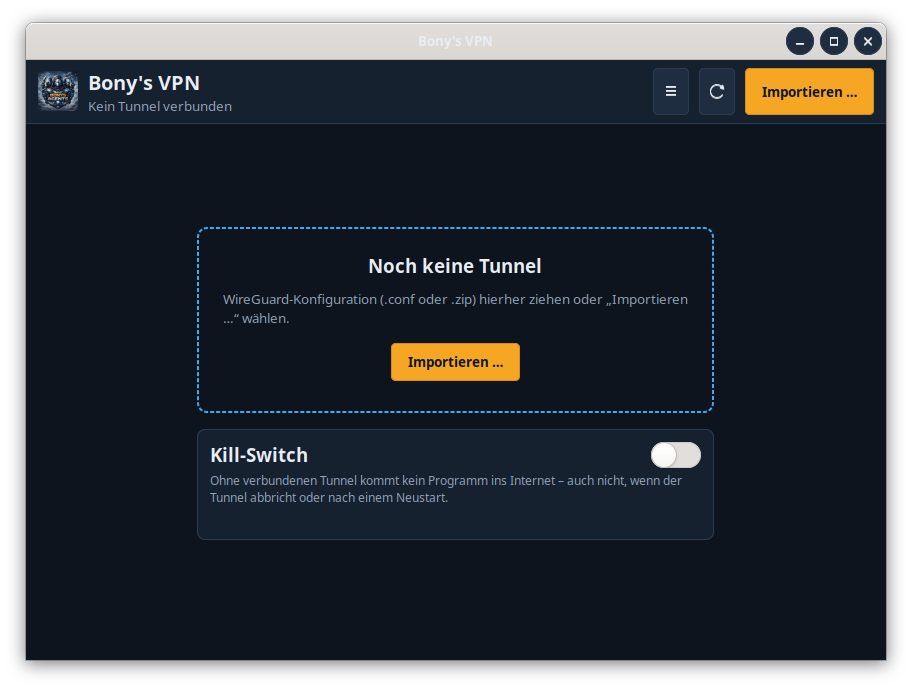
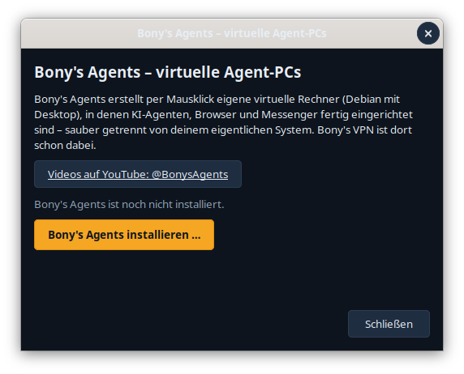

# Bony's VPN

**WireGuard-VPN mit Kill-Switch – einfach per Mausklick.** Für Debian, Ubuntu und Linux Mint.

Bony's VPN verwaltet WireGuard-Tunnel: Konfiguration deines VPN-Anbieters oder deiner Fritzbox importieren,
mit einem Klick verbinden, und auf Wunsch sorgt der Kill-Switch dafür, dass ohne Tunnel kein Programm ins
Internet kommt – auch nicht, wenn der Tunnel abbricht oder nach einem Neustart.



## Was es kann

- **Tunnelliste** mit Status, **ein Klick** zum Verbinden und Trennen (immer nur ein Tunnel gleichzeitig)
- **Live-Werte:** Adresse, DNS, Server, letzter Handshake, empfangene und gesendete Daten, öffentliche IP auf Knopfdruck
- **Import** per Dateiauswahl, Drag&Drop, mehrere Dateien auf einmal oder als ZIP, mit Rückfrage bei gleichem Namen
- **Bearbeiten** mit Prüfung, private Schlüssel bleiben verborgen. Umbenennen, Exportieren (nur für dich lesbar), Löschen
- **Automatisch verbinden** beim Hochfahren
- **Kill-Switch** (nftables): ohne Tunnel kein Internet. Ausnahmen für dein Heimnetz (Drucker, NAS) möglich
- **Symbol in der Leiste** mit Schnellwahl und **Meldung bei Abbruch**
- **Bony-Netz:** deine Agent-PCs aus Bony's Agents übers Internet erreichen, Geräte verwalten, diesen Rechner mit
  einem Schalter ins Netz bringen ([unten](#bony-netz))
- **Kommandozeile** `bonys-vpn` mit JSON-Ausgabe ([docs/cli.md](docs/cli.md))
- **Updates** über die Aktualisierungsverwaltung, sonst geprüft aus dem GitHub-Release
- Deutsch und Englisch

| Noch keine Tunnel | Bony's Agents |
|---|---|
|  |  |

## Installieren

**Debian 12/13, Ubuntu 22.04 oder neuer, Linux Mint 21 oder neuer – PC (amd64) und ARM (arm64):**

1. Auf der [Release-Seite](https://github.com/zappotex/bonys-vpn/releases/latest) die Datei
   `bonys-vpn_…_all.deb` herunterladen (ein Paket für alle Rechner).
2. Doppelklicken → die Softwareverwaltung öffnet sich → **„Installieren“**.

Oder im Terminal:

```bash
sudo apt install ./bonys-vpn_*_all.deb
```

Danach steht **„Bony's VPN“** im Startmenü. Alles Nötige (WireGuard, nftables, GTK) kommt aus den offiziellen
Paketquellen deines Systems. Das Paket richtet außerdem die Paketquelle von Bony's VPN ein, spätere Updates
kommen also über die **Aktualisierungsverwaltung**. Wer [Bony's Agents](https://github.com/zappotex/BonysAgents)
schon installiert hat, kann auch einfach `sudo apt install bonys-vpn` eingeben.

> **Nur `bonys-vpn` installieren.** Das zweite Paket `bonys-vpn-agentpc` ist ausschließlich für die virtuellen
> Agent-PCs von Bony's Agents gedacht (dort darf man das VPN ohne Passwort steuern). Bony's Agents installiert
> es dort selbst.

Entfernen: `sudo apt remove bonys-vpn` – der Kill-Switch wird dabei abgeschaltet, deine Tunnel in
`/etc/wireguard` bleiben. `sudo apt purge bonys-vpn` löscht zusätzlich die Einstellungen in `/etc/bonys-vpn`.

## Erste Schritte

1. **Konfiguration besorgen:** eine `.conf`-Datei von deinem VPN-Anbieter oder aus deiner Fritzbox
   (*Internet → Freigaben → VPN (WireGuard)*).
2. **Importieren:** „Importieren …“ klicken oder die Datei ins Fenster ziehen. Beim ersten Mal erklärt ein
   Hinweis, dass das VPN dann für deinen ganzen Rechner gilt.
3. **Verbinden:** Tunnel auswählen → „Verbinden“. Dein Rechner fragt nach dem **Administrator-Passwort** und
   merkt es sich einige Minuten. „Öffentliche IP → Prüfen“ zeigt, ob du jetzt über den VPN-Server ins Internet gehst.
4. Optional: **Automatisch verbinden** und **Kill-Switch** einschalten.

### Kill-Switch

Ist der Kill-Switch an, kommt ohne verbundenen Tunnel **kein Programm** auf deinem Rechner ins Internet, auch
nach einem Neustart nicht, bis du ihn wieder abschaltest. Fällt dein VPN-Server aus, bist du also offline.
Deshalb fragt Bony's VPN vor dem Einschalten noch einmal nach. Geräte im Heimnetz erreichst du ohne Tunnel nur,
wenn du ihr Netz unter **Menü → Kill-Switch-Ausnahmen …** einträgst (z. B. `192.168.178.0/24`).

### Konfigurationen mit Befehlen

Manche Konfigurationen enthalten Zeilen wie `PostUp = …`. Das sind Befehle, die beim Verbinden **als
Administrator** laufen. Bony's VPN übernimmt sie nur nach einer deutlichen Warnung – nur bestätigen, wenn du
der Datei vertraust.

### Tunnel aus dem NetworkManager

Hast du einen WireGuard-Tunnel schon über die Netzwerkeinstellungen eingerichtet, zeigt Bony's VPN ihn an.
Trennen kann ihn aber nur der NetworkManager (Netzwerk-Symbol in der Leiste). Zwei Tunnel für den ganzen
Rechner stören sich, deshalb bittet Bony's VPN vor dem Verbinden darum, den anderen zu trennen.

## Bony-Netz

Neben den WireGuard-Tunneln hat das Fenster einen zweiten Bereich **„Bony-Netz“** (oben rechts umschalten). Über
das Bony-Netz verbinden sich die Agent-PCs aus [Bony's Agents](https://github.com/zappotex/BonysAgents) übers
Internet – und auf Wunsch auch dieser Rechner.

- **Server und Instanz:** Standard ist `https://zentrale.bony23.de`, ein eigener Server geht auch („Prüfen“). Die
  Instanz ist deine Anmeldung beim Server. Bony's Agents und Bony's VPN teilen sich diese Anmeldung
  (`~/.config/bonys-netz/konto.json`): Eine in Bony's Agents angelegte Instanz erscheint hier sofort.
- **Agenten-PCs:** alle Geräte deiner Instanz mit Netzadresse, online/offline und „zuletzt gesehen“, aktualisiert
  alle 30 Sekunden, solange der Bereich offen ist. „Entfernen …“ nimmt ein Gerät nach Rückfrage aus dem Netz.
- **Kursleiter-Code einlösen** schaltet die Instanz für Kurse frei.
- **Diesen Rechner verbinden:** bringt deinen Rechner mit [Tailscale](https://tailscale.com) ins Netz deiner
  Instanz – danach erreichst du deine Agent-PCs unter ihrer Netzadresse (z. B. `ping 100.64.0.7`). Fehlt
  Tailscale, bietet Bony's VPN die Installation aus der offiziellen Paketquelle `pkgs.tailscale.com` an.
  Ausschalten trennt nur (`tailscale down`), beim Wiedereinschalten braucht es keinen neuen Schlüssel.
  Dein Rechner nimmt dabei **keine Verbindungen an** (`--shields-up`) – auch nicht von deinen eigenen Agent-PCs, in
  denen KI-Agenten laufen. Du erreichst sie, sie dich nicht.
  Ist auf dem Rechner schon ein **anderes Tailscale-Konto** angemeldet, fragt Bony's VPN vorher: Es wird beim
  Verbinden ersetzt, bleibt aber als Profil erhalten (`tailscale switch`).

Ohne Instanz nimmt Bony's VPN keinen Kontakt zum Server auf, ohne Internet funktionieren die Tunnel wie immer.
Ist der **Kill-Switch** an, ist auch das Bony-Netz ohne verbundenen Tunnel gesperrt; mit verbundenem Tunnel geht
es, wenn `100.64.0.0/10` unter **Menü → Kill-Switch-Ausnahmen …** steht (darauf weist der Bereich hin). Im
Agent-PC gibt es den Bereich nicht – den verbindet Bony's Agents selbst.

## Kommandozeile

```text
bonys-vpn list
bonys-vpn status [NAME] [--json]
bonys-vpn up NAME | down [NAME]
bonys-vpn import DATEI.conf|DATEI.zip … [--name NAME] [--ersetzen] [--hooks-erlauben]
bonys-vpn delete NAME [--ja] | rename ALT NEU | export NAME [DATEI]
bonys-vpn autostart NAME an|aus
bonys-vpn killswitch an|aus|status [--ausnahme NETZ …] [--keine-ausnahmen]
bonys-vpn version [--json]
```

Mit `--json` ist die Kommandozeile die **offizielle Schnittstelle** für andere Programme, mit Schema-Version:
[docs/cli.md](docs/cli.md).

## Bony's Agents

Bony's VPN kommt von [Bony's Agents](https://github.com/zappotex/BonysAgents): Damit erstellst du per Mausklick
eigene virtuelle Rechner (Agent-PCs), in denen KI-Agenten, Browser und Messenger fertig eingerichtet sind –
sauber getrennt von deinem eigentlichen System. In jedem Agent-PC ist Bony's VPN dabei. Videos gibt es auf
YouTube: [@BonysAgents](https://www.youtube.com/@BonysAgents).

Im Menü von Bony's VPN öffnet **„Bony's Agents – virtuelle Agent-PCs …“** Bony's Agents oder installiert es
nach Rückfrage aus der offiziellen Quelle (Paketquelle oder geprüftes Release).

## Sicherheit

- Die Oberfläche läuft als dein Benutzer. Root-Rechte bekommt nur ein kleiner Helfer (`bonys-vpn-helper`) über
  polkit, und der darf nur genau festgelegte Aktionen. Konfigurationen bekommt er über die Standardeingabe, nie
  als Pfad.
- Schlüssel liegen nur in `/etc/wireguard` (nur für root lesbar) und erscheinen in keiner Anzeige, keinem
  Protokoll und keiner JSON-Ausgabe.
- Updates und Bony's Agents werden nur aus dem offiziellen Release installiert, nach Prüfung der
  minisign-Signatur und der SHA-256-Prüfsumme. Tailscale nur aus der offiziellen Paketquelle von Tailscale.
- Bony-Netz: Das Instanz-Token liegt nur in `konto.json` (Rechte 600) und erscheint nirgends. Der einmal nutzbare
  Geräteschlüssel geht nur über die Standardeingabe an den Helfer, nie über die Befehlszeile.

Alles im Detail: [docs/sicherheit.md](docs/sicherheit.md).

## Entwickeln

```bash
sudo apt install python3-venv python3-gi gir1.2-gtk-3.0 libgtk-3-bin
python3 -m venv --system-site-packages .venv && .venv/bin/pip install -e ".[dev]"
.venv/bin/ruff check src tests && .venv/bin/pytest -q
packaging/build-deb.sh        # → dist/bonys-vpn_<version>_all.deb, dist/bonys-vpn-agentpc_<version>_all.deb
```

Ein Release entsteht mit einem Tag `vX.Y.Z` (siehe `.github/workflows/release.yml`).

## Lizenz

GPL-3.0-or-later, siehe [LICENSE](LICENSE). Copyright © 2026 Bony.
